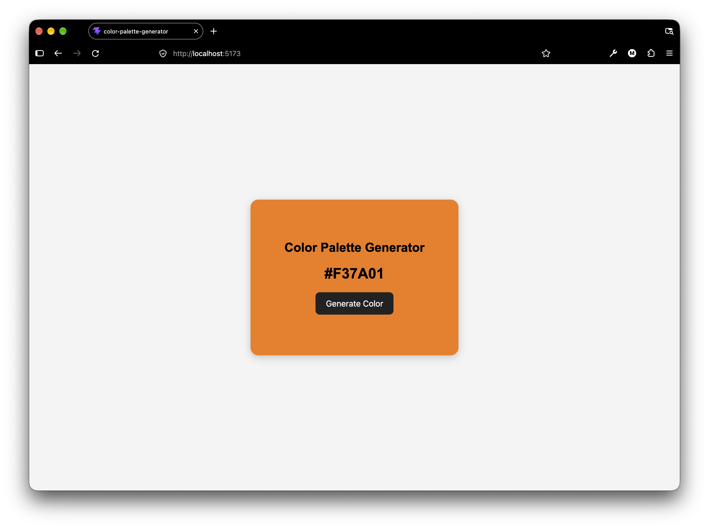

# Color Palette Generator

A simple and interactive color palette generator built with **React** and **Vite**. Generate a random color with one click and copy its HEX code to use in your designs.

## Preview



## Features

- Displays a color card with the current background color.
- Generates a random six-digit HEX color when you click **Generate Color**.
- Shows the current HEX color code on the card.
- Click the HEX code to copy it to your clipboard.
- Starts with the default color `#F37A01`.

## Tech Stack

- React 19
- JavaScript
- CSS
- Vite

## Getting Started

### Prerequisites

Make sure you have **Node.js** and **npm** installed.

### Installation

1. Download or clone this project.
2. Open the project folder in your terminal.
3. Install the project dependencies:

   ```bash
   npm install
   ```

### Run the Application

Start the local development server:

```bash
npm run dev
```

Open the local URL shown in your terminal (Vite commonly uses `http://localhost:5173`).

## Available Scripts

| Command | Description |
| --- | --- |
| `npm run dev` | Starts the development server. |
| `npm run build` | Creates an optimized production build in the `dist` folder. |
| `npm run preview` | Previews the production build locally. |
| `npm run lint` | Runs ESLint to check the code. |

## How to Use

1. Open the application in your browser.
2. The color card initially displays `#F37A01`.
3. Click **Generate Color** to generate a new random color.
4. Click the displayed HEX code to copy it to your clipboard.

## Project Structure

```text
color-palette-generator/
├── public/
├── src/
│   ├── App.jsx
│   ├── App.css
│   ├── index.css
│   └── main.jsx
├── screenshots/
│   └── color-palette-generator.png
├── index.html
├── package.json
├── package-lock.json
├── vite.config.js
└── README.md
```

## License

This project is intended for learning and educational use.
